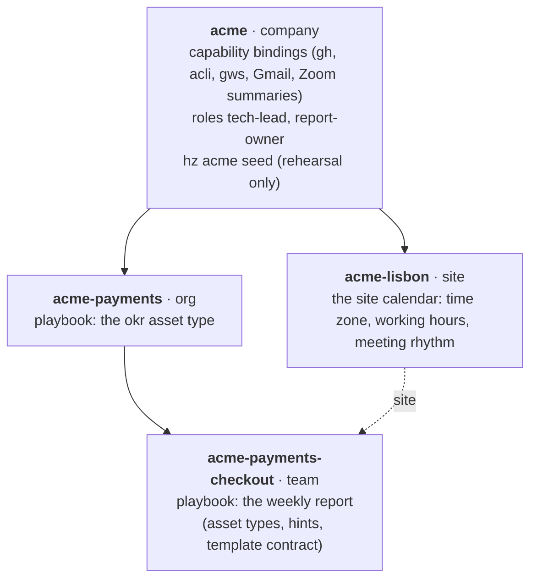

# heinzel-acme

The reference company for [Heinzelmännchen](https://github.com/helmut-hoffer-von-ankershoffen/heinzel): a made-up
company, **Acme** (acme.example), modelled end to end as four plugins in one repository, the way a real company keeps
its own plugins in a private repository. It is the worked example of Heinzelmännchen's layers and playbooks
([core ADR 0040](https://github.com/helmut-hoffer-von-ankershoffen/heinzel/blob/main/docs/adr/0040-layers-and-playbooks-are-plugins.md),
[ADR 0037](https://github.com/helmut-hoffer-von-ankershoffen/heinzel/blob/main/docs/adr/0037-plugins-bring-playbooks.md))
and their test bed.

Everything here is fiction: the company, its org Payments, its team Checkout, its site Lisbon, its people and its
documents.

[](https://github.com/helmut-hoffer-von-ankershoffen/heinzel-acme/actions/workflows/ci.yml)
[](https://github.com/helmut-hoffer-von-ankershoffen/heinzel-acme/tree/python-coverage-comment-action-data)

## The layers



Each box is a plugin, named after its path from the root (`heinzel-<name>`). A layer declares its parent and, for a
team, its site; Heinzelmännchen stacks a person's layers **general to specific**: for Checkout that is `acme`, then
`acme-payments` and `acme-lisbon`, then `acme-payments-checkout`. A more specific layer refines a more general one,
and nothing any layer brings becomes your configuration until you accept it (`hz setup`).

| Plugin | Layer | What it brings |
| --- | --- | --- |
| [`heinzel-acme`](src/heinzel_acme/) | company | Bindings for code host (GitHub, `gh`), tracker (Jira, `acli`), documents, calendar and mail (Google Workspace, `gws`) and meetings (Zoom's summary e-mails), offered by `hz setup acme`; roles; a doctor check per binding; `hz acme layers`; `hz acme seed` |
| [`heinzel-acme-payments`](plugins/heinzel-acme-payments/) | org | A playbook with the `okr` asset type: the org's quarterly OKR document |
| [`heinzel-acme-lisbon`](plugins/heinzel-acme-lisbon/) | site | The site calendar as data (`hz acme-lisbon calendar`): Europe/Lisbon, 09:00 to 18:00, stand-up, planning, demo, the Friday 17:00 report deadline |
| [`heinzel-acme-payments-checkout`](plugins/heinzel-acme-payments-checkout/) | team | The weekly report playbook: asset types (weekly report document, engineering tracker, tracker project, code repository) with discovery hints, and the template contract `acme-payments-checkout:weekly-report`, a draft ready by Friday 17:00 |

## Install and look

With Heinzelmännchen installed (see [Pins](#pins) for the version):

```bash
hz system plugin add "git+https://github.com/helmut-hoffer-von-ankershoffen/heinzel-acme#subdirectory=plugins/heinzel-acme-payments-checkout"
```

One plugin, the team's: its org, site and company come with it, as its dependencies. Then:

```bash
hz system layer list        # the tree, from the core (a core with the layer API)
hz system layer show        # your stack: acme → acme-payments + acme-lisbon → acme-payments-checkout
hz acme layers              # the same tree as Acme declares it, on any core
hz acme info                # the bindings Acme recommends and how they stand on this machine
hz system doctor            # which adapter plugins and logins are missing
hz workflow playbooks       # what each layer's playbook offers
hz setup acme               # accept the bindings you want, one by one
hz acme-lisbon calendar     # the site's week, at the site and on this machine
```

The first-party adapter plugins the bindings name are separate: `hz system plugin add github`, `atlassian`, `zoom`
and `google`, each with its vendor CLI logged in as you; `hz system doctor` lists what is missing with the command
that fixes it.

## The weekly report

```bash
hz workflow new weekly-report --template acme-payments-checkout:weekly-report \
  --asset weekly-report=<doc id> --asset engineering-tracker=<sheet id> \
  --asset tracker-project=CHK --asset code-repo=<owner>/acme-checkout
hz workflow run weekly-report --dry-run     # the inputs, fetched through gh, acli and gws; no agent, no cost
hz workflow run weekly-report               # the draft, saved locally for you to edit and send
```

To try it against a real (trial) world, [docs/REHEARSAL.md](docs/REHEARSAL.md) walks a manager and an engineer through
it on two machines, with `hz acme seed` creating the Acme world in your own trial accounts.

## Port it to your company

[docs/PORT_TO_YOUR_COMPANY.md](docs/PORT_TO_YOUR_COMPANY.md) is the runbook a coding agent (or you) follows to create a
private `heinzel-<company>` repository with the same shape: what to rename, how to bind your company's own providers
through a private layer, and what to verify first. This repository plus that runbook is the hand-off.

## Pins

Acme builds against Heinzelmännchen's `main` until a release has what it uses:

| What | Where | Today | Switch to |
| --- | --- | --- | --- |
| Heinzelmännchen for tests and e2e | `pyproject.toml` (`test` group), `tests/e2e/install_test.py` | the head of the core's pull request #61, "plugins are layers" (on top of `main`: playbooks, gh and acli adapters) | the first release that has the layer API |
| The layer API (`Module.layer`) | [`src/heinzel_acme/layers.py`](src/heinzel_acme/layers.py), the one bridge | forwarded to the core when it has `Module.layer` (`hz system layer list`), recorded by Acme otherwise (`hz acme layers`) | once released and pinned: `module.layer(...)` in each plugin, and drop the bridge |
| The Google adapter | not a dependency | the core's open pull request | `hz system plugin add google` once released |

## Develop

```bash
make setup     # dependencies, pinned tools, git hooks
make check     # lint, types, unit and integration tests of all four plugins (offline)
make test-e2e  # installs Heinzelmännchen with uv and adds the team plugin from this checkout
```

Read [AGENTS.md](AGENTS.md) first. The plugins are one uv workspace: the company layer at the root, the others in
`plugins/`, released together at one version. Tests use fakes and never reach a network; `hz acme seed` refuses to
run the real CLIs inside a test session.

## Release

Actions → **Release** → Run workflow opens a release pull request; merging it tags and publishes all four plugins. The
version comes from conventional commits, the changelog from git-cliff. `main` changes only through pull requests.

This repository was generated from Heinzelmännchen's copier template; `make update-template` pulls in its latest
standards, tooling and CI.
