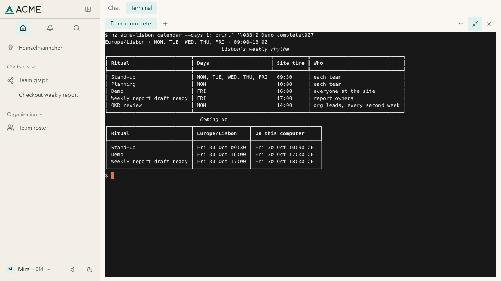
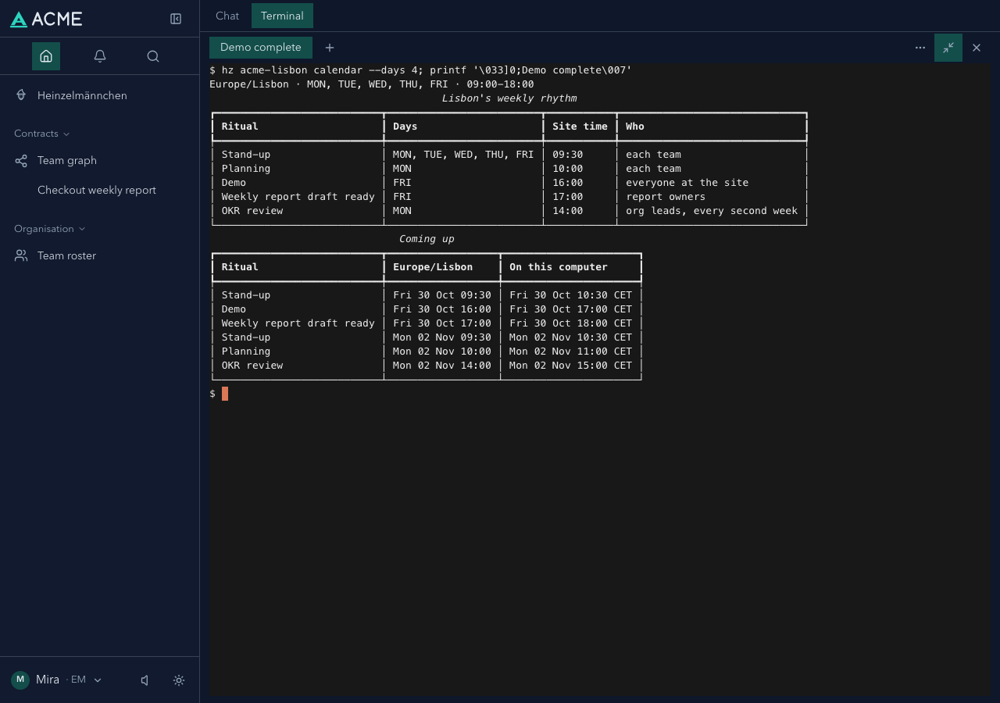
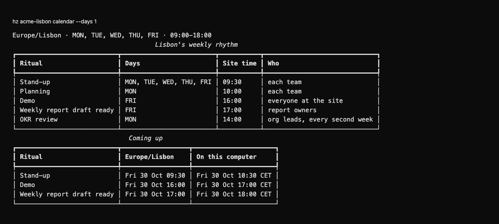

# heinzel-acme-lisbon

The site layer of [heinzel-acme](../../README.md), Heinzelmännchen's made-up reference company: **ACME Lisbon**,
under the company layer `acme` and beside the org tree. It brings the site calendar as data: the time zone
(Europe/Lisbon, a setting `[acme-lisbon] time_zone` its playbook recommends), working hours, and the rhythm of
stand-up, planning, demo and the Friday 17:00 weekly report deadline.

You do not install this layer on its own: it comes with the Checkout team, which depends on it. See [Install and look](../../README.md#install-and-look).

## Gallery

Real captures with fictional demonstration data and unconnected accounts.

[](https://helmut.hoffer-von-ankershoffen.me/heinzel/catalog/heinzel-acme-lisbon-f5f1f19a1e/)

*Friday stand-up, demo and the 17:00 report deadline in site and computer time.*

[](https://helmut.hoffer-von-ankershoffen.me/heinzel/catalog/heinzel-acme-lisbon-f5f1f19a1e/)

*A four-day window crosses the weekend to Monday's stand-up, planning and OKR review.*

<details>
<summary>See the CLI output</summary>

[](https://helmut.hoffer-von-ankershoffen.me/heinzel/catalog/heinzel-acme-lisbon-f5f1f19a1e/)

*Working hours, weekly rhythm and Friday's upcoming events in site and computer time.*

</details>

[View the full gallery on the plugin page →](https://helmut.hoffer-von-ankershoffen.me/heinzel/catalog/heinzel-acme-lisbon-f5f1f19a1e/)

```bash
hz acme-lisbon calendar --days 7     # at the site and on this machine
hz setup acme-lisbon
```
