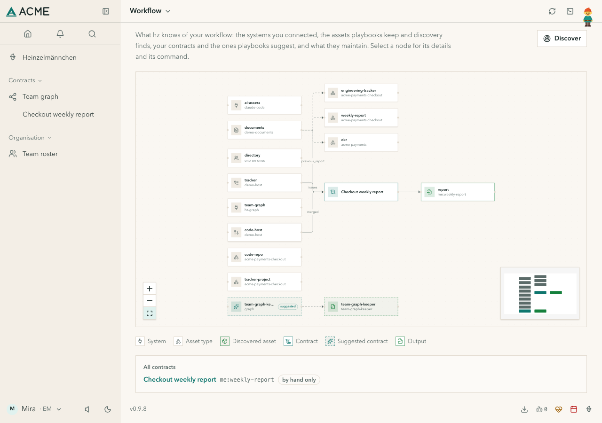
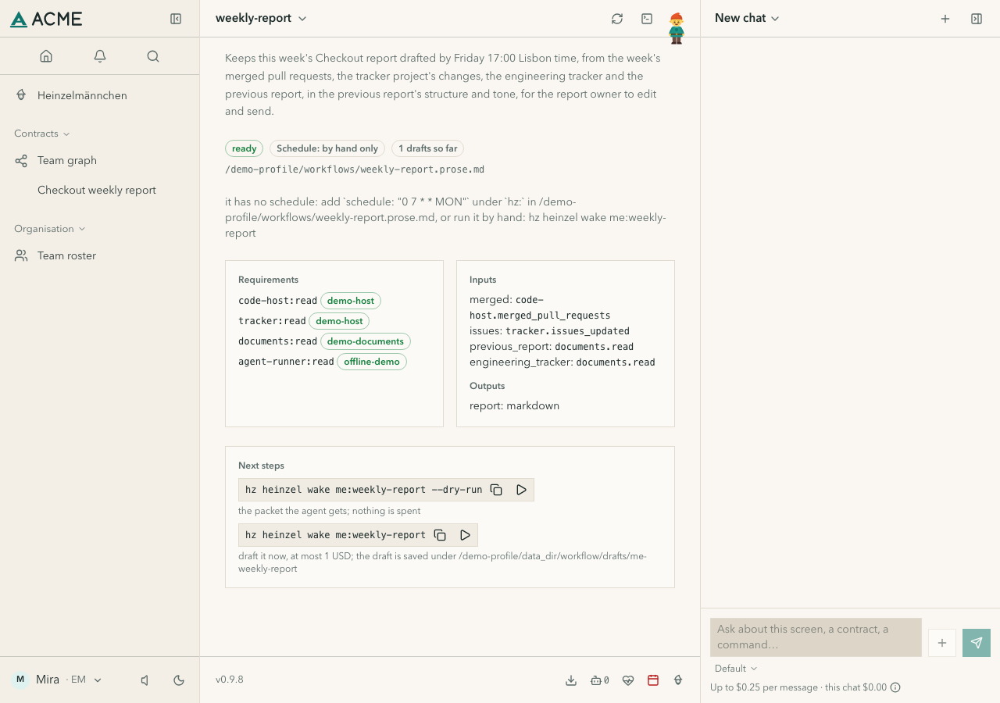
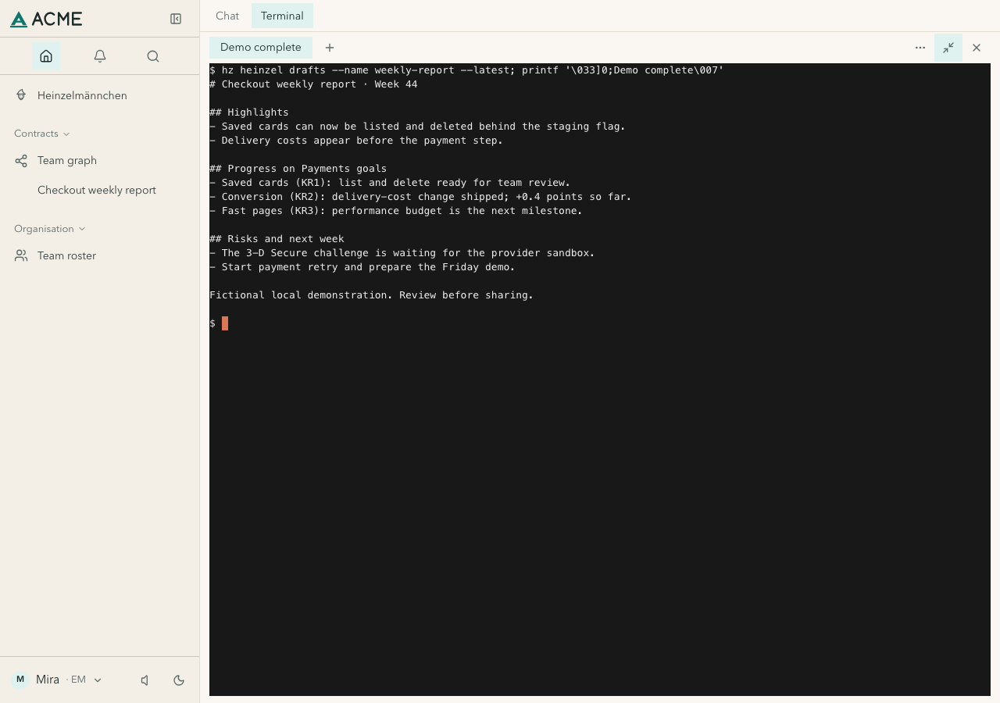
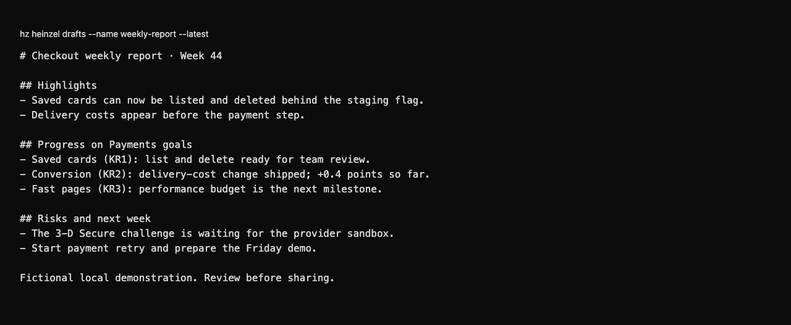

# heinzel-acme-payments-checkout

The team layer of [heinzel-acme](../../README.md), Heinzelmännchen's made-up reference company: **Checkout**, a team
of the org `acme-payments` at the site `acme-lisbon`. Installing it installs its stack: `acme`, `acme-payments`,
`acme-lisbon`.

## Install

Start Heinzelmännchen with `uvx heinzel@latest` ([installation guide](https://helmut.hoffer-von-ankershoffen.me/heinzel/guides/install/)), then in a second terminal:

```bash
hz system plugin add "git+https://github.com/helmut-hoffer-von-ankershoffen/heinzel-acme#subdirectory=plugins/heinzel-acme-payments-checkout" --confirm
```

The org, site and company layers come with it.

## Gallery

Real captures with fictional demonstration data and unconnected accounts.

[](https://helmut.hoffer-von-ankershoffen.me/heinzel/catalog/heinzel-acme-payments-checkout-8a7d294621/)

*Checkout's report connects code, tracker and documents.*

[](https://helmut.hoffer-von-ankershoffen.me/heinzel/catalog/heinzel-acme-payments-checkout-8a7d294621/)

*A compiled weekly-report contract with its inputs and local draft.*

[](https://helmut.hoffer-von-ankershoffen.me/heinzel/catalog/heinzel-acme-payments-checkout-8a7d294621/)

*A locally saved fictional draft from a deterministic demo runner, in the app terminal.*

<details>
<summary>See the CLI output</summary>

[](https://helmut.hoffer-von-ankershoffen.me/heinzel/catalog/heinzel-acme-payments-checkout-8a7d294621/)

*The same locally saved fictional report, ready to review and edit.*

</details>

[View the full gallery on the plugin page →](https://helmut.hoffer-von-ankershoffen.me/heinzel/catalog/heinzel-acme-payments-checkout-8a7d294621/)

It brings the weekly report playbook:

- asset types `weekly-report` (the rolling report document, kept by the template), `engineering-tracker` (the
  tracker sheet), `tracker-project` (the Jira project key) and `code-repo` (the repository), with hints where a
  capability can confirm one;
- the template contract `acme-payments-checkout:weekly-report`: a draft ready by Friday 17:00 Lisbon time from the
  week's merged pull requests (code host), changed items (tracker), the engineering tracker and the previous report
  (documents), in the previous report's structure and tone, saved locally for the report owner;
- the draft tags for approving in place (core ADR 0038), shown by `hz acme-payments-checkout info`.

```bash
hz heinzel new weekly-report --template acme-payments-checkout:weekly-report --asset weekly-report=<id> ...
hz heinzel wake weekly-report --dry-run
```
