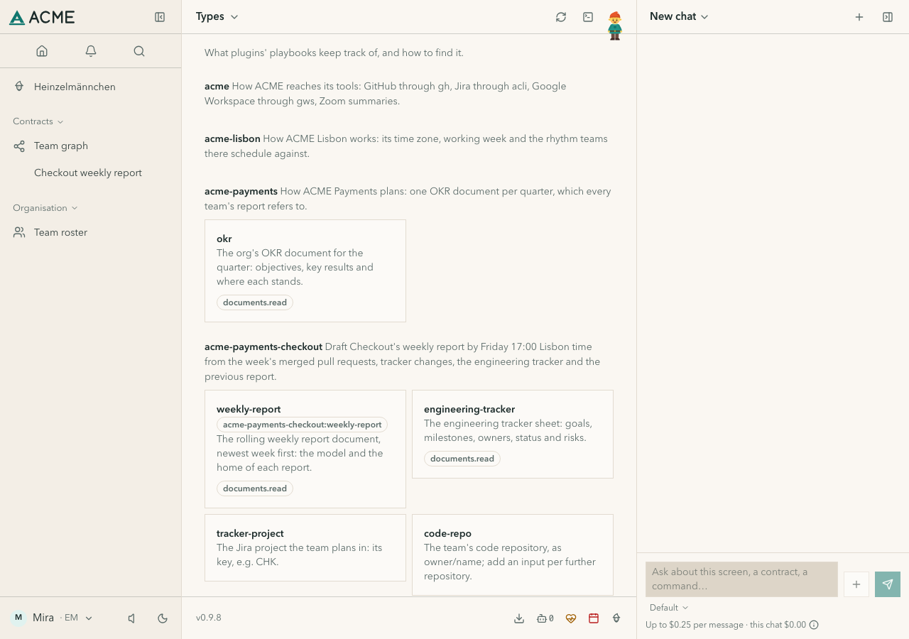
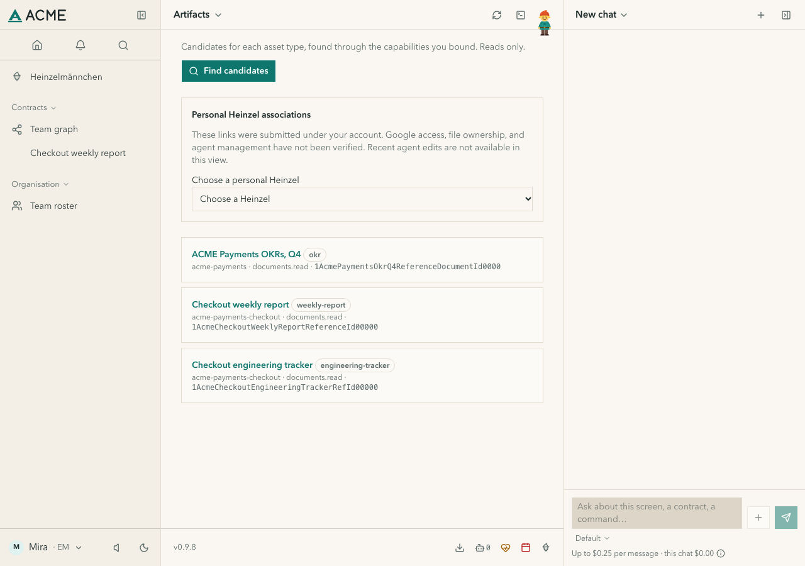
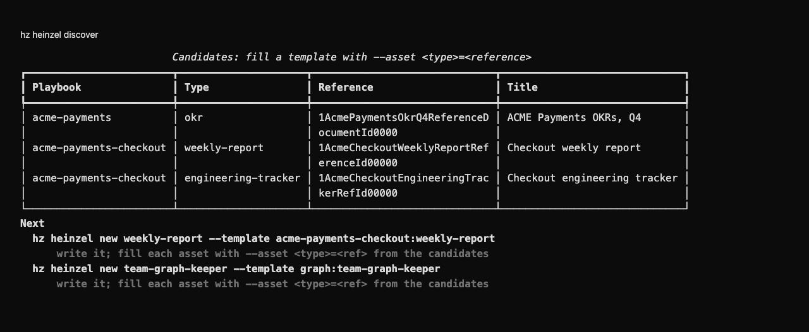

# heinzel-acme-payments

The org layer of [heinzel-acme](../../README.md), Heinzelmännchen's made-up reference company: **ACME Payments**,
under the company layer `acme`. It brings how the org plans: a playbook with the `okr` asset type, the quarter's OKR
document, and a hint that confirms the org's own document. Every team below it reads it through its stack.

You do not install this layer on its own: it comes with the Checkout team, which depends on it. See [Install and look](../../README.md#install-and-look).

## Gallery

Real captures with fictional demonstration data and unconnected accounts.

[](https://heinzel.team/catalog/heinzel-acme-payments-f39fc70bf6/)

*ACME Payments supplies the quarterly OKR asset type.*

[](https://heinzel.team/catalog/heinzel-acme-payments-f39fc70bf6/)

*Discover the fictional OKRs, weekly report and engineering tracker through a local demo adapter.*

<details>
<summary>See the CLI output</summary>

[](https://heinzel.team/catalog/heinzel-acme-payments-f39fc70bf6/)

*Actual asset discovery using fictional ACME documents served by the offline demo adapter.*

</details>

[View the full gallery on the plugin page →](https://heinzel.team/catalog/heinzel-acme-payments-f39fc70bf6/)

```bash
hz acme-payments info
hz heinzel playbooks
```
